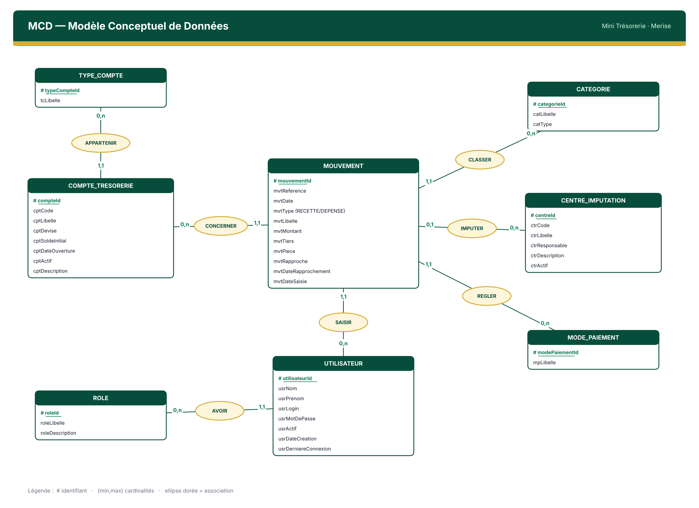
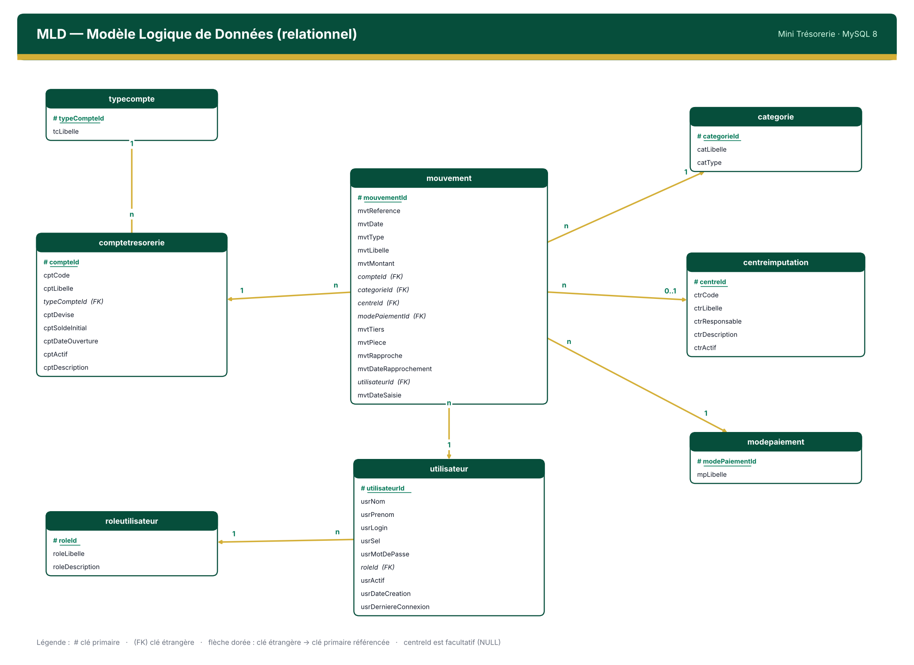

# Mini Trésorerie — Solution de gestion d'une mini trésorerie

Application de bureau **C# Windows Forms (.NET 8)** sur base **MySQL 8**, architecture en 3 projets :

```
MiniTresorerie/
├── Database/                         Scripts SQL (à exécuter dans l'ordre)
│   ├── 01_schema.sql                 Base, tables, contraintes
│   ├── 02_sp_referentiels.sql        CRUD : types de compte, modes de paiement, catégories, centres
│   ├── 03_sp_comptes_mouvements.sql  CRUD : comptes, mouvements, fonction de solde, vue
│   ├── 04_sp_utilisateurs_stats.sql  Authentification, utilisateurs, statistiques
│   └── 05_donnees_initiales_demo.sql Rôles, référentiels, comptes, 160 mouvements de démonstration
├── MCD_MiniTresorerie.png            Modèle conceptuel de données
├── MLD_MiniTresorerie.png            Modèle logique de données
├── docs/                             Dictionnaire des données et règles de gestion (MCD_MLD.md)
├── MiniTresorerie.Models/            Classes métier (une par table) + objets de statistiques
├── MiniTresorerie.DataAccess/        Connexion, DAO, appels aux procédures stockées (MySql.Data)
├── MiniTresorerie.UInterface/        Interface Windows Forms : tous les formulaires ont un fichier .Designer.cs (visibles dans le concepteur)
│   ├── Principal/                    FrmDemarrage (écran de chargement), FrmConnexion, FrmPrincipal (menu latéral + zone de contenu)
│   ├── Listes/                       Une liste par table : FrmCompteListe, FrmMouvementListe, FrmCategorieListe, FrmCentreListe,
│   │                                 FrmModePaiementListe, FrmTypeCompteListe, FrmUtilisateurListe (colonnes de grille définies dans le designer)
│   ├── Details/                      Une fenêtre par table : FrmXxxDetail (ajout, modification, consultation, suppression) + FrmMotDePasse
│   ├── Pages/                        FrmTableauDeBord, FrmRapprochement, FrmRapports
│   ├── Composants/                   Thème, logo, panneaux décoratifs, graphiques GDI+ (barres, anneau, classement)
│   └── Outils/                       Aide commune, export CSV/Excel, impression, PDF, montant en lettres, session
└── slnMiniTresorerie.sln
```

## Modélisation





## Installation

1. Démarrer MySQL 8 puis exécuter les scripts `Database/01` à `05` **dans l'ordre** (MySQL Workbench : *File > Open SQL Script > Exécuter*).
2. Ouvrir `slnMiniTresorerie.sln` dans Visual Studio (le projet de démarrage est `MiniTresorerie.UInterface`).
3. Adapter la chaîne de connexion si besoin dans `MiniTresorerie.UInterface/connexion.config`
   (par défaut : `Server=localhost;User ID=root;Password=;`).
4. Dans l'Explorateur de solutions : clic droit sur `MiniTresorerie.UInterface` > **Définir en tant que projet de démarrage**.
5. Les packages NuGet (`MySql.Data`) se restaurent automatiquement. Lancer avec F5.

Pour modifier un écran : double-cliquer sur le formulaire (ex. `Listes/FrmCompteListe.cs`) ouvre le concepteur ; après une modification des colonnes ou des contrôles, générer la solution (Ctrl+Maj+B).

## Comptes de démonstration

| Identifiant | Mot de passe | Rôle |
|-------------|--------------|------|
| admin | Admin@123 | Admin : tout, y compris la gestion des utilisateurs |
| comptable | Compta@123 | Comptable : saisie, rapprochement, rapports, paramètres |
| lecteur | Lecteur@123 | Lecteur : consultation, impression et exports uniquement |

Les mots de passe sont stockés sous la forme `SHA2(sel + mot de passe)` ; le sel est unique par utilisateur.

## Fonctionnalités

- **Authentification** avec rôles, changement de mot de passe, déconnexion.
- **Tableau de bord** : trésorerie totale, recettes, dépenses, résultat ; histogramme mensuel, répartition des dépenses par catégorie, dépenses par centre, dernières opérations ; filtres année / mois.
- **Comptes de trésorerie** (caisse, banque, mobile money, épargne) avec solde calculé.
- **Mouvements** (recettes / dépenses) : filtres par période, compte, type, état de pointage ; **reçu / bon de décaissement imprimable** avec montant en lettres.
- **Centres d'imputation analytique**, catégories, modes de paiement, types de compte.
- **Rapprochement** : pointage des mouvements, comparaison avec le solde du relevé, écart.
- **Rapports** : journal, situation des comptes, synthèse par catégorie, synthèse par centre ; **impression, export PDF, export Excel (CSV)** depuis toutes les listes.
- Règles de gestion en base : pas de solde négatif, mouvement pointé verrouillé, compte clôturé bloqué, dernier administrateur protégé.

## Notes

- L'interface utilise uniquement la police **Segoe UI** et des contrôles Windows Forms standards : l'affichage suit la mise à l'échelle de Windows (100 %, 125 %, 150 %…).
- L'export PDF utilise l'imprimante virtuelle « Microsoft Print to PDF » (incluse dans Windows 10/11).
- L'export « Excel » produit un CSV (séparateur `;`, UTF-8) qui s'ouvre directement dans Excel.

## Équipe

- Kouadio Ketsia
- Kodja Esther
- Essane Jean-Noël
- Biagou Marc-Aurel

## Licence

Projet pédagogique, tous droits réservés à l'équipe.
