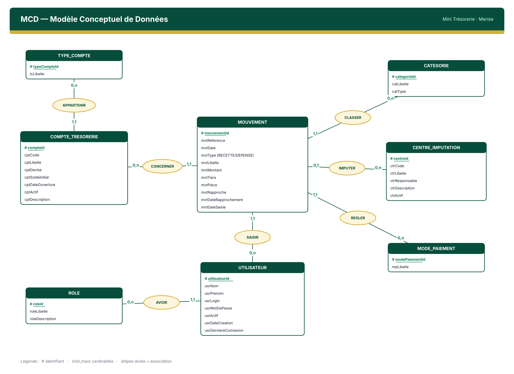
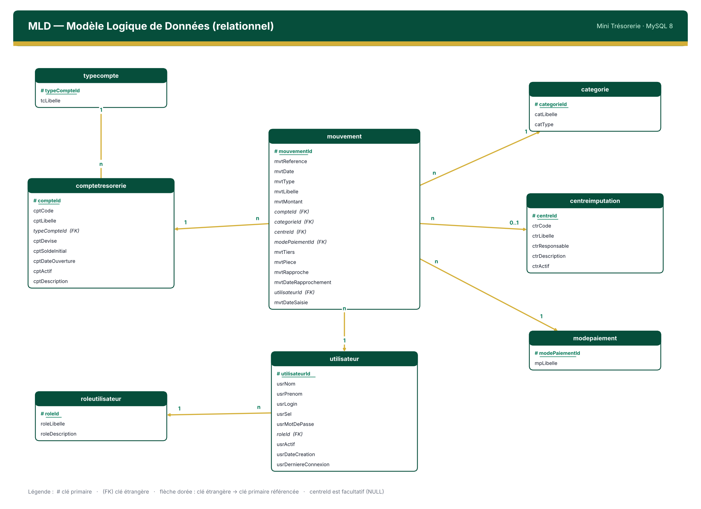

# Mini Trésorerie — Conception de la base de données

## 1. Règles de gestion (base du MCD)

| N° | Règle |
|----|-------|
| R1 | Un **compte de trésorerie** appartient à un seul **type de compte** (Caisse, Banque, Mobile Money, Épargne) ; un type regroupe plusieurs comptes. |
| R2 | Un **mouvement** (recette ou dépense) concerne un seul compte et une seule catégorie ; il est réglé par un seul mode de paiement. |
| R3 | Un mouvement peut être imputé à **un centre d'imputation analytique** (facultatif) ; un centre reçoit plusieurs mouvements. |
| R4 | Un mouvement est saisi par un seul **utilisateur** ; un utilisateur possède un seul **rôle** (Admin, Comptable, Lecteur). |
| R5 | Le montant d'un mouvement est strictement positif ; son sens (entrée / sortie) est donné par son type. |
| R6 | Une dépense est refusée si le solde du compte devient négatif. |
| R7 | Un mouvement **pointé** (rapproché) ne peut plus être modifié ni supprimé. |
| R8 | Un compte clôturé n'accepte plus de mouvement. Il reste toujours au moins un administrateur actif. |

## 2. Dictionnaire des données

| Table | Colonnes (PK souligné dans le MLD, FK entre parenthèses) |
|-------|-----------------------------------------------------------|
| roleutilisateur | **roleId**, roleLibelle, roleDescription |
| utilisateur | **utilisateurId**, usrNom, usrPrenom, usrLogin, usrSel, usrMotDePasse, (roleId), usrActif, usrDateCreation, usrDerniereConnexion |
| typecompte | **typeCompteId**, tcLibelle |
| modepaiement | **modePaiementId**, mpLibelle |
| categorie | **categorieId**, catLibelle, catType (RECETTE/DEPENSE) |
| centreimputation | **centreId**, ctrCode, ctrLibelle, ctrResponsable, ctrDescription, ctrActif |
| comptetresorerie | **compteId**, cptCode, cptLibelle, (typeCompteId), cptDevise, cptSoldeInitial, cptDateOuverture, cptActif, cptDescription |
| mouvement | **mouvementId**, mvtReference, mvtDate, mvtType, mvtLibelle, mvtMontant, (compteId), (categorieId), (centreId), (modePaiementId), mvtTiers, mvtPiece, mvtRapproche, mvtDateRapprochement, (utilisateurId), mvtDateSaisie |

## 3. Passage MCD → MLD

Chaque association « 1,1 — 0,n » devient une **clé étrangère** dans l'entité côté (1,1) : aucune table d'association n'est nécessaire.
L'association IMPUTER (0,1 — 0,n) donne la clé étrangère `centreId`, **nullable**, dans `mouvement`.

## 4. Procédures stockées

| Domaine | Procédures |
|---------|------------|
| Référentiels | `SP_{TypeCompte, ModePaiement, Categorie, Centre}_{Create, ReadAll, ReadById, Update, Delete}`, `SP_Role_ReadAll` |
| Comptes | `SP_Compte_{Create, ReadAll, ReadById, Update, Delete}`, fonction `FN_SoldeCompte` |
| Mouvements | `SP_Mouvement_{Create, ReadAll, ReadById, Update, Delete, Rapprocher}` + vue `vw_mouvement_detail` |
| Utilisateurs | `SP_Utilisateur_{Authentifier, Create, ReadAll, ReadById, Update, Delete, ChangerMotDePasse}` |
| Statistiques | `SP_Stats_{Kpi, Mensuel, ParCategorie, ParCentre}` |
